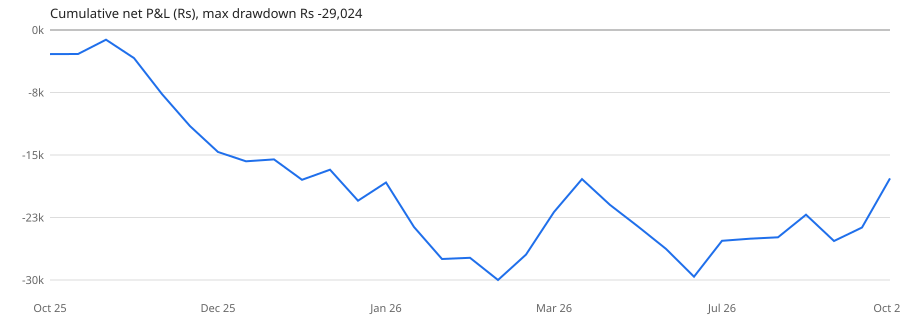

# Full-system backtest: 2025-10-01 to 2026-10-16

Run label `orb_monday_norisk`, 258 trading sessions, generated 2026-10-20 21:12.  Overrides: {'ENABLE_EMA_STRATEGY': 'false', 'ENABLE_ORB_STRATEGY': 'true', 'ENABLE_PIVOT_STRATEGY': 'false', 'ENABLE_VWAP_STRATEGY': 'false', 'ENABLE_TRB_STRATEGY': 'false', 'ENABLE_MOMENTUM_PHASE': 'false', 'ENABLE_NATR_STRATEGY': 'false', 'ENABLE_PDHL_STRATEGY': 'false', 'ENABLE_OB_STRATEGY': 'false', 'ENABLE_ATR_COPILOT_STRATEGY': 'false', 'ORB_MOMENTUM_SKIP_MONDAY': 'false', 'MAX_RISK_RUPEES_PER_TRADE': '5000'}.

## Headline

| Metric | Value |
|---|---:|
| Trades | 31 |
| Win % | 48.40 |
| Net P&L (Rs) | -17,924 |
| Gross P&L (Rs) | -14,787 |
| Costs (Rs) | 3,137 |
|   of which charges (Rs) | 1,897 |
|   of which slippage (Rs) | 1,240 |
| Avg cost per trade (Rs) | 101 |
| Profit factor | 0.65 |
| Avg trade (Rs) | -578 |
| Avg win (Rs) | 2,185 |
| Avg loss (Rs) | -3,168 |
| Largest win (Rs) | 5,933 |
| Largest loss (Rs) | -5,376 |
| Max drawdown (Rs) | -29,024 |
| Longest losing streak | 5 |
| Avg hold (min) | 213 |

Trades on 31 of 258 sessions; 48% of trading days were green.  Average 2.5 trades a month.

## By strategy and side

| strategy | side | Trades | Win % | Net Rs | Avg Rs | PF |
|---|---|---:|---:|---:|---:|---:|
| ORB | CE | 17 | 52.90 | -1,521 | -89 | 0.93 |
| ORB | PE | 14 | 42.90 | -16,403 | -1,172 | 0.43 |

## Exit reasons

Every exit carries the reason recorded by the bot itself (`trades.exit_reason`).

| exit_reason | Trades | Win % | Net Rs | Avg Rs | PF | Avg hold min |
|---|---:|---:|---:|---:|---:|---:|
| IDX_SL_HIT | 10 | 0 | -33,936 | -3,394 | 0 | 121 |
| IDX_TSL_HIT | 9 | 100 | 29,211 | 3,246 | inf | 222 |
| TIME_DECAY | 8 | 62.50 | -6,091 | -761 | 0.12 | 314 |
| STOP_HIT | 3 | 0 | -9,834 | -3,278 | 0 | 189 |
| EOD_SQUARE_OFF | 1 | 100 | 2,726 | 2,726 | inf | 335 |

### Exit reason by strategy (trade count)

| exit_reason | ORB |
|---|---:|
| EOD_SQUARE_OFF | 1 |
| IDX_SL_HIT | 10 |
| IDX_TSL_HIT | 9 |
| STOP_HIT | 3 |
| TIME_DECAY | 8 |

## Stop-loss and trailing-stop behaviour

`stage_at_exit` is the furthest stop stage reached: INITIAL = the original SL, BE = moved to break-even, T1/T2 = Pivot profit locks, TRAIL = chandelier trailing stop.  `sl_moves` counts broker stop modifications.

| stage_at_exit | Trades | Win % | Net Rs | Avg Rs | PF |
|---|---:|---:|---:|---:|---:|
| INITIAL | 22 | 27.30 | -47,135 | -2,142 | 0.07 |
| TRAIL | 9 | 100 | 29,211 | 3,246 | inf |

- Trades whose stop moved at least once: 9 of 31 (29%); average 4.5 moves per trade.

- Full initial-stop losses: 22 (71%).

- Of the 10 trades that reached +1R, the exit kept on average 70% of the best index move (median 71%); 0% of them still closed at a net loss.

- Median best move (MFE) 0.70R; 32% of trades reached +1R at some point.

## Stability

### First half vs second half of the period

| half | Trades | Win % | Net Rs | Avg Rs | PF |
|---|---:|---:|---:|---:|---:|
| H1 | 19 | 42.10 | -21,979 | -1,157 | 0.38 |
| H2 | 12 | 58.30 | 4,055 | 338 | 1.27 |

### By year

| year | Trades | Win % | Net Rs | Avg Rs | PF |
|---|---:|---:|---:|---:|---:|
| 2025 | 10 | 30 | -18,095 | -1,810 | 0.10 |
| 2026 | 21 | 57.10 | 171 | 8 | 1.01 |

### By month

| month | Trades | Win % | Net Rs | Avg Rs | PF | Cumulative Rs |
|---|---:|---:|---:|---:|---:|---:|
| 2025-10 | 4 | 50 | -3,397 | -849 | 0.34 | -3,397 |
| 2025-11 | 2 | 0 | -8,209 | -4,105 | 0 | -11,606 |
| 2025-12 | 4 | 25 | -6,489 | -1,622 | 0.03 | -18,095 |
| 2026-01 | 5 | 40 | -9,568 | -1,914 | 0.26 | -27,663 |
| 2026-02 | 3 | 66.70 | 534 | 178 | 1.20 | -27,129 |
| 2026-03 | 1 | 100 | 5,150 | 5,150 | inf | -21,979 |
| 2026-05 | 3 | 33.30 | -1,759 | -586 | 0.69 | -23,738 |
| 2026-06 | 1 | 0 | -2,704 | -2,704 | 0 | -26,442 |
| 2026-07 | 2 | 50 | 977 | 489 | 1.29 | -25,465 |
| 2026-08 | 1 | 100 | 259 | 259 | inf | -25,206 |
| 2026-09 | 4 | 75 | 1,349 | 337 | 1.42 | -23,857 |
| 2026-10 | 1 | 100 | 5,933 | 5,933 | inf | -17,924 |

50% of months were profitable.

## Timing

### Entry hour

| entry_hour | Trades | Win % | Net Rs | Avg Rs | PF |
|---|---:|---:|---:|---:|---:|
| 09:00 | 31 | 48.40 | -17,924 | -578 | 0.65 |

### Weekday

| weekday | Trades | Win % | Net Rs | Avg Rs | PF |
|---|---:|---:|---:|---:|---:|
| Mon | 5 | 60 | -1,735 | -347 | 0.73 |
| Tue | 12 | 41.70 | -7,983 | -665 | 0.66 |
| Wed | 7 | 57.10 | -2,961 | -423 | 0.71 |
| Fri | 7 | 42.90 | -5,245 | -749 | 0.51 |

### Expiry day vs other days

| expiry_day | Trades | Win % | Net Rs | Avg Rs | PF |
|---:|---:|---:|---:|---:|---:|
| no | 30 | 46.70 | -23,074 | -769 | 0.54 |
| yes | 1 | 100 | 5,150 | 5,150 | inf |

## Signal funnel

Raw signals are strategy conditions that fired on a closed candle; most are removed by the entry gates below before any order.

| Signal | Raw signals |
|---|---:|
| CE_ORB | 41 |
| PE_ORB | 40 |

### Top reasons signals were blocked

| Block (event: reason) | Count |
|---|---:|
| ORB_BLOCKED_THURSDAY | 300 |
| ENTRY_BLOCKED_MAX_RISK | 8 |
| SMART_ENTRY_BLOCKED_SLOPE: EMA# not rising for CE | 6 |

## Best and worst trades

### Best 10

| entry_dt | strategy | side | entry_price | exit_price | exit_reason | stage_at_exit | net_pnl |
|---|---|---|---:|---:|---|---|---:|
| 2026-10-13 09:35:00 | ORB | CE | 445 | 748 | IDX_TSL_HIT | TRAIL | 5,933 |
| 2026-03-25 09:30:00 | ORB | CE | 344 | 606 | IDX_TSL_HIT | TRAIL | 5,150 |
| 2026-07-17 09:35:00 | ORB | CE | 583 | 805 | IDX_TSL_HIT | TRAIL | 4,330 |
| 2026-05-12 09:30:00 | ORB | PE | 484 | 688 | IDX_TSL_HIT | TRAIL | 3,969 |
| 2026-02-24 09:35:00 | ORB | PE | 417 | 576 | IDX_TSL_HIT | TRAIL | 3,065 |
| 2026-09-28 09:35:00 | ORB | PE | 404 | 546 | EOD_SQUARE_OFF | INITIAL | 2,726 |
| 2026-01-20 09:30:00 | ORB | PE | 331 | 447 | IDX_TSL_HIT | TRAIL | 2,201 |
| 2025-10-27 09:35:00 | ORB | CE | 464 | 555 | IDX_TSL_HIT | TRAIL | 1,722 |
| 2026-09-30 09:30:00 | ORB | CE | 304 | 391 | IDX_TSL_HIT | TRAIL | 1,622 |
| 2026-01-02 09:35:00 | ORB | CE | 457 | 523 | IDX_TSL_HIT | TRAIL | 1,219 |

### Worst 10

| entry_dt | strategy | side | entry_price | exit_price | exit_reason | stage_at_exit | net_pnl |
|---|---|---|---:|---:|---|---|---:|
| 2026-01-27 09:30:00 | ORB | PE | 483 | 219 | IDX_SL_HIT | INITIAL | -5,376 |
| 2025-11-07 09:40:00 | ORB | PE | 490 | 278 | IDX_SL_HIT | INITIAL | -4,342 |
| 2026-01-28 09:30:00 | ORB | CE | 374 | 185 | STOP_HIT | INITIAL | -3,873 |
| 2025-11-11 09:30:00 | ORB | PE | 395 | 207 | IDX_SL_HIT | INITIAL | -3,867 |
| 2026-01-12 09:30:00 | ORB | PE | 356 | 174 | IDX_SL_HIT | INITIAL | -3,738 |
| 2026-07-15 09:35:00 | ORB | CE | 305 | 142 | STOP_HIT | INITIAL | -3,353 |
| 2026-09-29 09:30:00 | ORB | PE | 341 | 187 | IDX_SL_HIT | INITIAL | -3,174 |
| 2025-12-09 09:30:00 | ORB | PE | 325 | 174 | IDX_SL_HIT | INITIAL | -3,128 |
| 2026-05-22 09:35:00 | ORB | CE | 698 | 547 | TIME_DECAY | INITIAL | -3,119 |
| 2025-10-08 09:35:00 | ORB | CE | 278 | 137 | IDX_SL_HIT | INITIAL | -2,913 |

## Configuration tested

| Setting | Value |
|---|---|
| ENABLE_PIVOT_STRATEGY | no |
| ENABLE_ORB_STRATEGY | yes |
| ENABLE_EMA_STRATEGY | no |
| ENABLE_VWAP_STRATEGY | no |
| ENABLE_TRB_STRATEGY | no |
| ENABLE_MOMENTUM_PHASE | no |
| ENABLE_NATR_STRATEGY | no |
| ENABLE_PDHL_STRATEGY | no |
| ENABLE_OB_STRATEGY | no |
| ENABLE_ATR_COPILOT_STRATEGY | no |
| QUANTITY | 20 |
| FORCE_EXIT_TIME | 15:10 |
| NO_NEW_ENTRY_AFTER | 15:00 |
| MAX_TRADES_PER_SIDE | 3 |
| ENABLE_DAILY_LOSS_LIMIT | yes |
| DAILY_LOSS_LIMIT_RUPEES | 5,000 |
| MAX_RISK_RUPEES_PER_TRADE | 5,000 |
| TREND_GATE_15M | yes |
| TREND_GATE_DAILY | yes |
| TREND_GATE_STRATEGIES | frozenset({'NATR', 'TRB', 'EMA', 'VWAP'}) |
| GENERIC_INDEX_EXITS | yes |
| PIVOT_BE_TRIGGER_R | 0.75 |
| PIVOT_BE_BUFFER_PTS | 25 |
| PIVOT_TRAIL_ATR_MULT | 1 |
| PIVOT_T2_TRAIL_ATR_MULT | 0.75 |
| PIVOT_MAX_TRADES_PER_DAY | 3 |
| PIVOT_OPTION_DELTA | 0.40 |
| EMA_NO_NEW_ENTRY_AFTER | 12:00 |
| EMA_TRAIL_ATR_MULT | 1 |
| EMA_BE_TRIGGER_R | 1 |
| BE_TRIGGER_RR | 1 |
| GENERIC_TRAIL_ATR_MULT | 2 |
| MAX_SL_PCT | 0.50 |
| ATM_DELTA | 0.50 |
| EXPIRY_DAY_ROLLOVER_TIME | 12:30 |
| ENABLE_SMART_EXIT | yes |

## How this backtest works

- **Production code, not a re-implementation.** Each session runs `main.BotContext`, `main.bootstrap_session`, the live tick handler, `execute_entry`, the Pivot / EMA / Index trade managers (SL, break-even, T1/T2 locks, chandelier trailing stop, targets), smart exits, the paper-broker SL backstop and `main._run_eod_exit`.  Signal de-duplication, daily caps, cooldowns, the trend gates, the rupee-risk cap and the daily loss limit all run from the bot's own SQLite tables.
- **No look-ahead.** The simulated Kite API only returns bars that had completed by the simulated time; signals fire on the first tick after a 5-minute candle closes, as live.
- **Price path.** Each 1-minute SENSEX bar is replayed as four ticks (up bar O,L,H,C; down bar O,H,L,C).  Intra-minute order beyond that is unknown.
- **Options are modelled, not historical.** Black-Scholes in trading time (weeknight = 176 min, weekend = 609 min), IV = India VIX (minute), r = 6.5%.  Strike selection, ITM fallback and expiry-day rollover use the bot's own selector on a synthetic chain; weekly expiry calendar [['2000-01-01', 4], ['2025-01-01', 1], ['2025-09-01', 3]] (weekday 0 = Monday), moved to the previous session on holidays.  The model has no volatility smile, no intraday IV crush beyond VIX moves, and VIX (30-day, NIFTY) is a proxy for weekly SENSEX IV — expect real premiums, especially on expiry days, to differ.
- **Fills and costs.** SHADOW-mode paper fills at the modelled premium, then 1.0 option point(s) of slippage per side plus brokerage, STT, exchange, SEBI, stamp duty and GST are deducted per trade.  Quantity is today's lot (20) throughout.
- **Not modelled:** order rejections, partial fills, feed outages, margin limits.

Files: `trades.csv` (one row per trade, with exit reason, stop stage, MFE/MAE and costs), `events.csv` (signals, blocks, stop moves), `run_meta.json` (full settings snapshot).  Re-run: `python -m research.system_backtest`.
